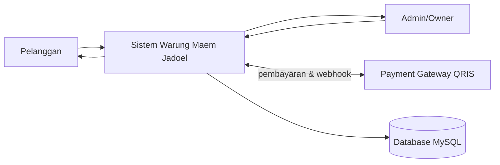

# DFD — Warung Maem Jadoel

## Level 0

## Level 1

```mermaid
flowchart LR
 P[Pelanggan] --> P1[1. Autentikasi]
 P --> P2[2. Self Order]
 P --> P3[3. Checkout & Pembayaran]
 A[Admin] --> P4[4. Operasional & Master Data]
 P1 --> DB[(Database)]
 P2 --> DB
 P3 --> DB
 P4 --> DB
 P3 <-->|create payment / webhook| G[Payment Gateway QRIS]
```

Self-order tidak lagi memakai QR meja. QR eksternal hanya mengarah ke URL website dan berada di luar kode aplikasi.

## Data utama
- `pelanggan`
- `menu`, `kategori_menu`, `topping`, `menu_topping`
- `meja`
- `transaksi_penjualan`, `detail_transaksi`
- `stok_produk`, `kartu_stok`
- `membership`, `reward_log`, `bonus_produk`
- `keuangan`
