# ERD Transformasi POS → E-Commerce — Warung Maem Jadoel

> Dokumen desain **sebelum implementasi**. Merujuk pada skema POS asli di `docs/ERD.md` dan
> `database/database.sql`. Prinsip: **evolusi, bukan rombak total** — tabel POS (katalog, stok,
> transaksi, Midtrans, reward) tetap terpakai.
>
> **Keputusan owner (revisi terbaru):**
> 1. Jasa pengiriman **di luar sistem** — owner sendiri yang memesan kurir lewat aplikasi
>    (Grab/Gojek/Shopee instan). Sistem tidak integrasi API kurir apa pun.
> 2. Pelanggan mengirim **alamat teks + titik lokasi** (koordinat/GMaps). Sistem menghitung
>    **jarak toko→pelanggan** dan mengestimasi ongkir.
> 3. Ongkir: **Rp 10.000 untuk 1 km pertama**; setiap kelipatan **500 m** di atasnya
>    **+ Rp 2.000** (mulai terkena di 1,5 km). *Rumus & angka bisa diubah admin.*
> 4. **Chat di dalam sistem** — owner ↔ pelanggan berkomunikasi lewat aplikasi, tanpa WA.

```mermaid
erDiagram
    %% ===== ENTITAS POS YANG SUDAH ADA (tidak berubah) =====
    USERS ||--o{ SYSTEM_NOTIFICATIONS : creates
    PELANGGAN ||--o{ PASSWORD_RESETS : requests
    PELANGGAN ||--|| MEMBERSHIP : has
    MEJA o|--o{ TRANSAKSI_PENJUALAN : hosts
    KATEGORI_MENU ||--o{ MENU : contains
    MENU ||--|| STOK_PRODUK : has
    STOK_PRODUK ||--o{ KARTU_STOK : records
    MENU ||--o{ MENU_TOPPING : allows
    TOPPING ||--o{ MENU_TOPPING : included
    MENU ||--o{ BONUS_PRODUK : reward
    BAHAN_BAKU ||--o{ KARTU_STOK_BAHAN : records
    TRANSAKSI_PENJUALAN ||--o{ DETAIL_TRANSAKSI : contains
    MENU ||--o{ DETAIL_TRANSAKSI : sold
    TOPPING ||--o{ DETAIL_TRANSAKSI : selected
    TRANSAKSI_PENJUALAN ||--o{ REWARD_LOG : triggers
    BONUS_PRODUK ||--o{ REWARD_LOG : snapshots
    TRANSAKSI_PENJUALAN ||--o{ ULASAN_PELANGGAN : "review lama (riwayat POS)"

    %% ===== FITUR E-COMMERCE: PELANGGAN =====
    PELANGGAN ||--o{ ALAMAT_PELANGGAN : owns
    PELANGGAN ||--o| KERANJANG : has
    KERANJANG ||--o{ KERANJANG_ITEM : contains
    MENU ||--o{ KERANJANG_ITEM : "in cart"
    TOPPING ||--o{ KERANJANG_ITEM : "with topping"
    PELANGGAN ||--o{ WISHLIST : saves
    MENU ||--o{ WISHLIST : "saved in"

    %% ===== FITUR E-COMMERCE: KATALOG & ULASAN =====
    MENU ||--o{ PRODUK_FOTO : "gallery"
    MENU ||--o{ ULASAN_PRODUK : reviewed
    DETAIL_TRANSAKSI ||--o| ULASAN_PRODUK : "proof of purchase"

    %% ===== FITUR E-COMMERCE: PESANAN, PENGIRIMAN, CHAT =====
    PELANGGAN ||--o{ TRANSAKSI_PENJUALAN : orders
    ALAMAT_PELANGGAN ||--o{ TRANSAKSI_PENJUALAN : "ship to"
    TRANSAKSI_PENJUALAN ||--o| PENGIRIMAN : delivers
    PENGATURAN_TOKO ||--o{ PENGIRIMAN : "ongkir dari jarak"
    TRANSAKSI_PENJUALAN ||--o| CHAT_THREAD : discusses
    CHAT_THREAD ||--o{ CHAT_PESAN : contains
    PELANGGAN ||--o{ CHAT_THREAD : participates

    %% ===== FITUR E-COMMERCE: VOUCHER =====
    VOUCHER ||--o{ VOUCHER_REDEMPTION : redeemed
    PELANGGAN ||--o{ VOUCHER_REDEMPTION : uses
    TRANSAKSI_PENJUALAN ||--o{ VOUCHER_REDEMPTION : "applies"
```



## 1. Ringkasan perubahan

| Kelompok | Status | Isi |
|---|---|---|
| POS (users, pelanggan, menu, kategori, topping, stok, meja, bonus, reward, keuangan, Midtrans) | **Tetap** | Dipakai apa adanya — warung tetap bisa dine-in/takeaway kasir |
| Alamat & Ongkir | **Baru** | `alamat_pelanggan` (teks + titik koordinat), `pengaturan_toko` (titik toko & tarif ongkir) |
| Pesanan | **Berubah** | `transaksi_penjualan` + jenis `DELIVERY`, ongkir, voucher |
| Pengiriman | **Baru** | `pengiriman` — snapshot alamat, jarak, status; kurir dipesan owner di aplikasi luar |
| Chat | **Baru** | `chat_thread`, `chat_pesan` — komunikasi owner↔pelanggan dalam sistem |
| Keranjang | **Baru** | `keranjang`, `keranjang_item` (permanen, ikut akun) |
| Voucher | **Baru** | `voucher` (NOMINAL / PERSEN / ONGKIR), `voucher_redemption` |
| Katalog | **Berubah** | `produk_foto` (galeri multi-foto) |
| Ulasan | **Berubah** | `ulasan_produk` (per item) — `ulasan_pelanggan` jadi riwayat POS |
| Wishlist | **Baru** (opsional) | `wishlist` |

## 2. Tabel baru

### `alamat_pelanggan` — buku alamat pelanggan (teks + titik lokasi)
| Kolom | Tipe | Ket |
|---|---|---|
| id | BIGINT UNSIGNED PK | |
| pelanggan_id | FK → pelanggan.id | CASCADE |
| label | VARCHAR(50) | "Rumah", "Kantor" |
| nama_penerima | VARCHAR(120) | |
| no_hp | VARCHAR(30) | |
| alamat | VARCHAR(255) | alamat teks + patokan |
| latitude | DECIMAL(10,7) | titik lokasi (GMaps/geolocation) |
| longitude | DECIMAL(10,7) | |
| is_utama | TINYINT(1) | 1 alamat utama per pelanggan |
| status_aktif | TINYINT(1) | hapus = nonaktif (riwayat aman) |

> Titik lokasi didapat dari: tombol "gunakan lokasi saya" (HTML5 Geolocation) atau pin di
> peta Google (tampilan peta hanya tampilan — tidak ada API berbayar yang disimpan ke sistem).

### `pengaturan_toko` — 1 baris: titik toko, tarif ongkir & batas jarak
| Kolom | Tipe | Ket default |
|---|---|---|
| id | BIGINT UNSIGNED PK | 1 |
| nama_toko | VARCHAR(120) | |
| latitude / longitude | DECIMAL(10,7) | titik toko (basis hitung jarak) |
| ongkir_dasar | DECIMAL(12,2) | 10000 |
| jarak_dasar_km | DECIMAL(5,2) | 1.00 |
| tarif_per_500m | DECIMAL(12,2) | 2000 |
| batas_jarak_km | DECIMAL(5,2) | **10.00** — di luar ini delivery ditolak |

**Rumus ongkir** (dihitung server saat checkout, dari jarak haversine toko→pelanggan):

```
jarak_km  = haversine(toko.lat, toko.lng, alamat.lat, alamat.lng)
kelipatan = max(0, CEIL((jarak_km − jarak_dasar_km) / 0.5))
ongkir    = ongkir_dasar + kelipatan × tarif_per_500m
```

| Jarak | Ongkir |
|---|---|
| ≤ 1,0 km | Rp 10.000 |
| 1,2 km → dibulatkan 1,5 km | Rp 12.000 |
| 2,0 km | Rp 14.000 |
| 3,1 km → dibulatkan 3,5 km | Rp 20.000 |
| **> 10 km** | **ditolak** — "di luar jangkauan pengiriman (maks. 10 km)" |

> Tarif saat ini **bersifat sementara** — akan disesuaikan owner setelah cek tarif asli
> ojol/aplikasi kurir. Semua angka ada di `pengaturan_toko`, cukup ubah dari panel admin.
>
> Kondisi jalan/macet **tidak dikelola sistem** (di luar prediksi aplikasi). Sifat pengiriman
> dibuat sesederhana mungkin: pesanan dikemas → diantar → sampai. Kabar dinamis (misalnya
> "kurir kena macet") cukup lewat **chat dalam sistem** yang memang ada per pesanan.

### `pengiriman` — 1 baris per transaksi DELIVERY (1:1)
| Kolom | Tipe | Ket |
|---|---|---|
| id | BIGINT UNSIGNED PK | |
| transaksi_id | FK → transaksi_penjualan.id UNIQUE | |
| alamat_id | FK NULL → alamat_pelanggan.id | referensi buku alamat |
| nama_penerima | VARCHAR(120) | **snapshot** saat checkout |
| no_hp_penerima | VARCHAR(30) | snapshot |
| alamat_teks | VARCHAR(500) | snapshot alamat lengkap |
| latitude / longitude | DECIMAL(10,7) | snapshot titik lokasi |
| jarak_km | DECIMAL(5,2) | hasil hitung saat checkout |
| biaya_ongkir | DECIMAL(12,2) | nilai yang ditagih (estimasi awal; bisa disesuaikan owner) |
| ongkir_status | ENUM('ESTIMASI','DIKONFIRMASI') | DEFAULT 'ESTIMASI' — QRIS dibuat hanya setelah DIKONFIRMASI |
| ekspedisi | VARCHAR(60) NULL | nama aplikasi yang owner pakai ("GrabInstant", "GoSend", dsb) |
| link_lacak | TEXT NULL | link tracking yang dibagikan aplikasi kurir (ditempel owner) |
| status | ENUM('DIPROSES','DIKIRIM','TIBA','DIBATALKAN') | sederhana, di-update owner |
| catatan | VARCHAR(255) NULL | catatan owner/kurir |
| dikirim_at / selesai_at | DATETIME NULL | |

> Kurir **dipesan owner melalui aplikasi pihak ketiga** (di luar sistem). Sistem hanya mencatat:
> biaya, nama aplikasi, dan (opsional) link lacak yang dibagikan aplikasi tersebut.

### `chat_thread` + `chat_pesan` — chat dalam sistem (per pesanan)
`chat_thread`: id PK, transaksi_id FK UNIQUE (1 pesanan = 1 ruang chat), pelanggan_id FK,
status ENUM('AKTIF','DITUTUP'), updated_at.
`chat_pesan`: id PK, thread_id FK CASCADE, pengirim ENUM('PELANGGAN','ADMIN'), isi TEXT,
lampiran VARCHAR NULL (opsional), dibaca_pelanggan_at, dibaca_admin_at, created_at.

- Pintu masuk: **halaman detail pesanan** (pelanggan) dan **detail pesanan** (admin).
- Realtime ringan: polling tiap beberapa detik seperti poll status pembayaran yang sudah ada —
  tanpa WebSocket/server tambahan.
- Notifikasi "pesan baru": badge di papan admin + di header pelanggan.
- owner memakai chat ini untuk kabar: "pesanan siap", "kurir sudah dipanggil", dsb — tanpa WA.

### `keranjang` + `keranjang_item` — keranjang permanen mengikuti akun
`keranjang`: id PK, pelanggan_id UNIQUE FK, updated_at.
`keranjang_item`: id PK, keranjang_id FK CASCADE, menu_id FK, topping_id FK NULL, level_pedas TINYINT NULL, qty INT UNSIGNED, UNIQUE(keranjang_id, menu_id, topping_id, level_pedas).

> Keranjang sesi yang sekarang (`$_SESSION['checkout']`) dipindah ke sini saat login —
> keranjang sama di HP dan laptop, tidak hilang saat sesi berakhir.

### `voucher` — 3 tipe penawaran
| Kolom | Tipe | Ket |
|---|---|---|
| id | BIGINT UNSIGNED PK | |
| kode | VARCHAR(40) UNIQUE | huruf besar |
| deskripsi | VARCHAR(255) | |
| tipe | ENUM('PERSEN','NOMINAL','ONGKIR') | ONGKIR = ongkir jadi Rp 0 |
| nilai | DECIMAL(12,2) | % / Rp potongan / Rp ongkir digratiskan |
| min_belanja | DECIMAL(12,2) | syarat minimum |
| maks_potongan | DECIMAL(12,2) NULL | untuk PERSEN |
| kuota_total | INT UNSIGNED | total pemakaian |
| kuota_per_pelanggan | INT UNSIGNED DEFAULT 1 | |
| tanggal_mulai / tanggal_selesai | DATE | masa aktif |
| status_aktif | TINYINT(1) | |

| Tipe | Contoh | Efek di checkout |
|---|---|---|
| NOMINAL | `MAEM10K` min. 50rb | total −Rp 10.000 |
| PERSEN | `JADOEL10` maks 15rb | −10%, dibatasi Rp 15.000 |
| ONGKIR | `GRATISONGKIR` | ongkir jadi Rp 0 |

Alur: input kode → validasi (aktif, masa promo, min_belanja, kuota) → potongan tampil di
ringkasan → saat pesanan dibuat: `voucher_id` + `potongan_voucher` tersimpan di transaksi dan
baris `voucher_redemption` tercatat. Kuota dihitung COUNT redemption (idempoten).
Admin: halaman kelola voucher + laporan pemakaian. Pelanggan: kolom input kode + ringkasan potongan.

### `voucher_redemption` — bukti pemakaian (idempoten)
id PK, voucher_id FK, pelanggan_id FK, transaksi_id FK, potongan DECIMAL(12,2),
tanggal, **UNIQUE(transaksi_id, voucher_id)** — 1 transaksi tak bisa klaim voucher sama dua kali.

### `produk_foto` — galeri multi-foto produk
id PK, menu_id FK CASCADE, file VARCHAR(255), urutan TINYINT, is_utama TINYINT(1).
`menu.foto` (lama) tetap dipakai sebagai fallback/foto kartu agar migrasi tidak mengejutkan.

### `ulasan_produk` — ulasan per item pembelian (inti e-commerce)
id PK, transaksi_id FK (bukti beli), detail_transaksi_id FK UNIQUE (1 item = 1 ulasan),
menu_id FK (denormalisasi agar rating cepat dihitung), pelanggan_id FK,
rating TINYINT CHECK 1–5, komentar TEXT, foto VARCHAR(255) NULL,
status_ulasan ENUM('MENUNGGU','DITAMPILKAN','DISEMBUNYIKAN'), created_at.
> `ulasan_pelanggan` (per transaksi) **dipertahankan sebagai data riwayat POS**; ulasan baru
> per-produk. Rating produk = AVG(ulasan_produk WHERE menu_id & DITAMPILKAN).

### `wishlist` (opsional, fase akhir)
id PK, pelanggan_id FK, menu_id FK, created_at, UNIQUE(pelanggan_id, menu_id).

## 3. Tabel yang berubah

### `transaksi_penjualan`
| Perubahan | Detail |
|---|---|
| `jenis_pesanan` | ENUM + `'DELIVERY'` → `('DINE_IN','TAKEAWAY','DELIVERY')` |
| `sumber_pesanan` | ENUM('WEBSITE','KASIR') DEFAULT 'WEBSITE' — diperluas nanti bila perlu kanal marketplace |
| `alamat_id` | FK NULL → alamat_pelanggan.id (wajib terisi saat DELIVERY, dijaga aplikasi) |
| `ongkir` | DECIMAL(12,2) DEFAULT 0 — hasil estimasi jarak |
| `voucher_id` | FK NULL → voucher.id |
| `potongan_voucher` | DECIMAL(12,2) DEFAULT 0 |
| `total_bayar` | rumus baru: subtotal + ongkir − potongan_voucher |
| `status_pesanan` | alur delivery: `MENUNGGU_PEMBAYARAN → MENUNGGU_KONFIRMASI → DIPROSES → DIKEMAS → SEDANG_DIANTAR → SELESAI` |
| CHECK lama | diganti: `(DINE_IN → meja_id NOT NULL) OR (TAKEAWAY) OR (DELIVERY)` — keharusan alamat dijaga aplikasi; meja_id NULL untuk DELIVERY |

Kolom Midtrans (`payment_reference`, `qris_url`, `payment_transaction_id`, `status_pembayaran`,
`stock_processed_at`, `reward_processed_at`) **tidak berubah**.

## 4. Alur baru yang didukung ERD ini

1. **Checkout delivery**: pelanggan pilih/ketik alamat + titik lokasi → sistem hitung jarak
   (haversine dari titik toko) → cek batas (maks `batas_jarak_km` = 10 km; lebih → ditolak dengan
   pesan "di luar jangkauan") → tampil estimasi ongkir (10rb + 2rb/500m) → total = subtotal +
   ongkir − voucher.
2. **Snapshot**: `pengiriman` menyimpan salinan alamat, koordinat, jarak, dan ongkir saat
   transaksi — riwayat tetap benar walau buku alamat diedit.
3. **Pembayaran**: QRIS Midtrans (webhook) / TUNAI — tidak berubah. **Khusus DELIVERY**: QR
   baru dibuat setelah owner mengonfirmasi ongkir (satu klik "Setujui" bila estimasi pas, atau
   ubah nilainya dulu) — supaya nominal yang dibayar pelanggan pasti dan transparan. Pesanan
   TUNAI/dine-in/takeaway tidak ikut langkah ini (tetap instan).
4. **Konfirmasi ongkir oleh owner**: pesanan delivery muncul di papan admin dengan label
   "Perlu Konfirmasi Ongkir" (terlihat: jarak, alamat, nominal estimasi). Owner klik **Setujui**
   (ongkir_status → DIKONFIRMASI) atau ubah nilai `biaya_ongkir` dulu lalu setujui. Halaman
   pelanggan (polling yang sudah ada) otomatis menyegarkan: QR tampil begitu ongkir
   dikonfirmasi. Owner juga bisa menjelaskan penyesuaian lewat chat per pesanan.
5. **Owner menagih kurir di luar sistem**: setelah terbayar & dikemas, owner pesan kurir
   di aplikasi ojol → tempel nama aplikasi & link lacak ke `pengiriman` → status DIKIRIM.
6. **Chat dalam sistem**: pelanggan & owner saling berkabar di ruang chat pesanan — termasuk
   memberi tahu "kurir sudah datang" tanpa keluar aplikasi.
7. **Ulasan**: setelah `SELESAI`, pelanggan mengulas tiap item (`ulasan_produk`, terkunci ke
   `detail_transaksi_id`) — rating tampil di halaman produk.

## 5. Rencana migrasi (urutan aman, satu file SQL per fase)

| Fase | SQL | Isi | Risiko |
|---|---|---|---|
| 0 | `migration_ecom_baseline.sql` | Backup + tabel `alamat_pelanggan`, `pengaturan_toko` | rendah (tabel baru murni) |
| 1 | `migration_ecom_delivery.sql` | ALTER `transaksi_penjualan` (enum DELIVERY, `sumber_pesanan`, ongkir, `alamat_id`, voucher, potongan) + tabel `pengiriman` | sedang (ALTER tabel inti — CHECK lama diganti) |
| 2 | `migration_ecom_chat.sql` | `chat_thread`, `chat_pesan` | rendah |
| 3 | `migration_ecom_keranjang.sql` | `keranjang`, `keranjang_item` + migrasi keranjang sesi aktif | rendah |
| 4 | `migration_ecom_voucher.sql` | `voucher` (NOMINAL/PERSEN/ONGKIR), `voucher_redemption` | rendah |
| 5 | `migration_ecom_katalog.sql` | `produk_foto` + kolom `menu.berat_gram`, `menu.slug` | rendah |
| 6 | `migration_ecom_ulasan_wishlist.sql` | `ulasan_produk` (+ seed dari `ulasan_pelanggan` lama), `wishlist` | sedang (seed data) |

Setiap file: `SET FOREIGN_KEY_CHECKS=0` di awal seperti konvensi `database.sql`, idempoten
(`CREATE TABLE IF NOT EXISTS`), dan dicatat di `docs/TESTING.md`.

## 6. Keputusan desain penting

- **Pengiriman di luar sistem**: tidak ada integrasi API kurir — owner memesan kurir sendiri
  di aplikasi; sistem mencatat nama aplikasi + link lacak + status.
- **Ongkir = rumus jarak**: dihitung server dari koordinat (anti manipulasi klien), tarif & batas
  jarak disimpan di `pengaturan_toko` sehingga owner bisa mengubah angka tanpa edit kode.
  Batas 10 km dipilih karena makanan harus tiba masih panas/layak santap.
- **Konfirmasi ongkir sebelum bayar**: khusus delivery, nilai ongkir final disetujui owner
  (`ongkir_status='DIKONFIRMASI'`) sebelum QR dibuat — pelanggan tidak membayar nominal
  yang bisa berubah, owner pegang kendali biaya nyata kurir. Transparan dua arah: pelanggan
  melihat estimasi + rincian jarak sejak awal, owner melihat alasan penyesuaian lewat chat.
- **Status pengiriman sesederhana mungkin**: DIKEMAS → DIKIRIM → TIBA. Kondisi jalan/macet tidak
  dikelola sistem — dinamika perjalanan cukup disampaikan lewat chat per pesanan.
- **Snapshot > referensi**: alamat, koordinat, jarak, dan ongkir disalin ke `pengiriman` —
  data historis tidak berubah walau buku alamat diedit atau tarif diganti.
- **Nonaktif, bukan hapus**: `alamat_pelanggan.status_aktif` — alamat lama yang pernah dipakai
  transaksi tidak boleh hilang dari FK.
- **Chat ringan**: polling, tanpa server WebSocket — pola yang sama dengan poll status
  pembayaran yang sudah berjalan di sistem ini.
- **Voucher idempoten**: `UNIQUE(transaksi_id, voucher_id)` + kuota via COUNT, sesuai pola
  `reward_processed_at` yang sudah ada (anti dobel).
- **Ulasan terkunci bukti beli**: `UNIQUE(detail_transaksi_id)` — hanya yang benar-benar
  memesan & transaksi `SELESAI` yang bisa mengulas, 1 item 1 ulasan.
- **POS tetap hidup**: dine-in/takeaway kasir tidak berubah — sistem hybrid
  (toko online + kasir warung).
- **Midtrans tidak tersentuh**: alur QRIS + webhook + panel diagnostik yang sudah jadi
  dipakai persis seperti sekarang.
