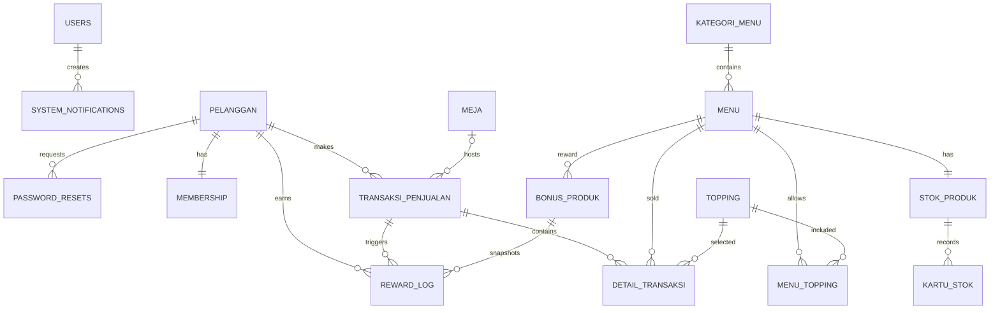

# ERD — Warung Maem Jadoel

## Catatan desain
- `menu` menyimpan setiap ukuran/rasa sebagai produk terpisah.
- `detail_transaksi` menyimpan topping dan level pedas per item.
- `reward_log.bonus_produk_id` menjaga histori bonus tetap menunjuk ke produk bonus yang benar.
- `pelanggan.total_produk_kumulatif` menyimpan pool kumulatif yang hanya bertambah dari transaksi dengan qty < 10.
- `transaksi_penjualan.jenis_pesanan` membedakan `DINE_IN` dan `TAKEAWAY`. Pada takeaway, `meja_id` boleh NULL; pada dine-in, `meja_id` wajib terisi.
